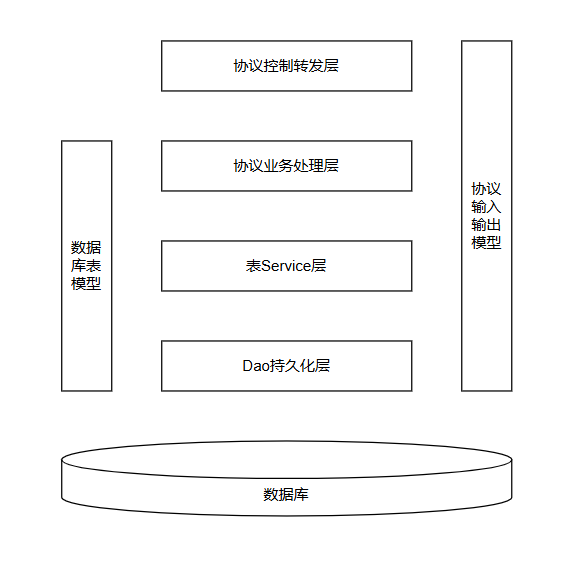
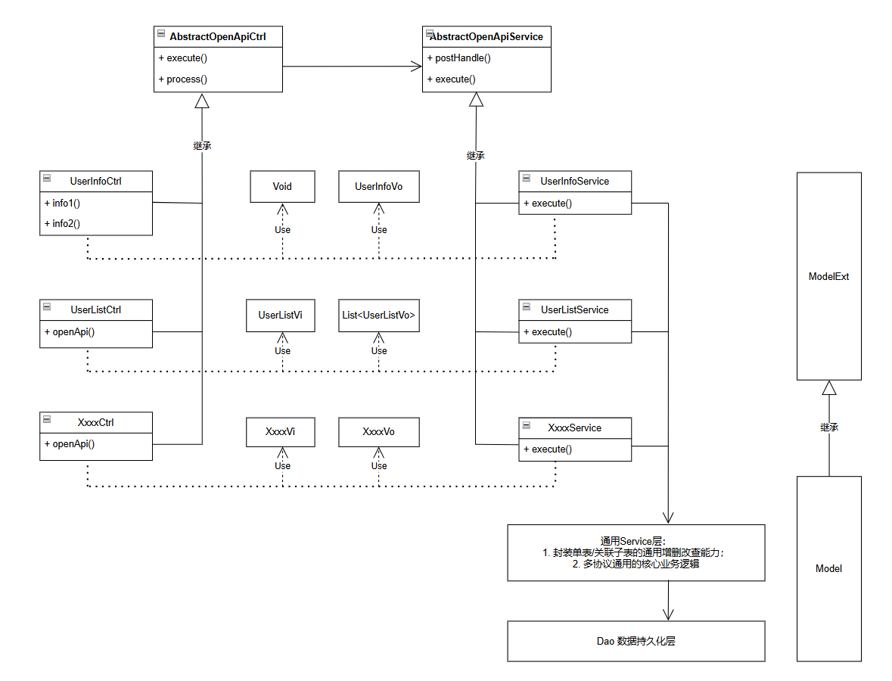

# 协议驱动

协议驱动设计围绕三大核心原则落地，适配轻量化、高迭代的开发场景。


## 三大核心思想具体如下：

1. **接口即协议，独立闭环**：

    每一个API接口对应一套独立协议，各协议拥有专属的入参模型、出参模型、业务处理类，业务逻辑完全闭环。


2. **协议扁平对等，无相互依赖**：

    所有协议处于同一层级、地位平等，无上下级、无优先级区分，禁止协议之间相互调用、耦合依赖。


3. **协议用完即弃，迭代换新**：

    协议适配当前业务场景即可，一旦出现场景不适配、大规模不兼容迭代，不改造旧协议，直接全新创建协议，旧协议保留、按需废弃。

<br>

极度适配中小团队敏捷迭代，实现**主动拥抱需求变化、核心业务保持恒定**；

+ 无需复杂 DDD 领域建模、无需高强度代码评审；

+ 适配**工期紧、需求多变、无详细前置设计**的开发场景；

+ 用轻量化架构解决传统分层架构职责混乱、代码失控的顽疾。

~~*哪里有敏捷开发？只不过是把工期紧任务重并且没有详细设计加上边做边想甚至是先做出来再说这种开发流程美化一番好让程序猿同学有种非常高大上的错觉从而心甘情愿地多加班而已*~~


---------

## 业务背景

在遥远的sevlet年代，一个sevlet将业务逻辑处理、数据持久化包干。

后来拆分成‘模型 - 视图 - 控制器’三层，又添加并细分‘Controller -> Service -> Dao’：

- Controller：负责请求接收、参数校验、路由调度与响应返回；

- Service：专注核心业务逻辑的编排与实现；

- Dao：负责数据库交互、数据持久化操作。

<br>

这套分层架构虽实现了基础职责拆分，但在中小团队、高频迭代的业务场景中，暴露了无法规避的短板：

1. Service层代码臃肿膨胀：随着业务迭代迭代，大量业务逻辑堆砌在Service类中，多人协作开发时极易出现代码冲突、分支合并问题，文件体量持续失控。


2. 层级边界混乱，隔离失效：受开发人员能力、规范落地不到位影响，层级职责经常被打破：部分开发者会将业务逻辑写入Controller层；甚至直接在控制层通过Dao、JDBC操作数据库；即便项目已定义标准化入参模型，仍存在通过`request.getParameter()`手动获取参数的不规范操作。


3. 架构适配性有限：大厂可通过领域驱动设计（DDD）、严格代码评审、规范化研发流程保障代码质量、延长代码生命周期。但绝大多数小微企业无专职代码审核人员，研发人员能力参差不齐，传统分层架构的规范难以落地，代码冗余、耦合、混乱问题愈发严重，维护成本极高。


<br>

> 协议驱动设计，正是针对中小团队快速迭代、规范薄弱、业务多变的场景，提出的轻量化破局方案。


---------


## 协议驱动核心思想深度解析

### 1. 最小颗粒度协议拆分，业务完全闭环

协议对应的API接口，需拆分至**最小业务颗粒**，以业务场景、功能单一为拆分依据：

  - 即便同为Banner图查询接口，若A、B两处返回数据格式不同，需拆分为两个独立协议；

  - 新增、编辑类操作，若业务逻辑、数据校验规则不同，可独立拆分协议；

  - 坚决杜绝“大一统接口”，禁止一个接口承载页面全部数据返回、多场景复合业务处理。


同时，每个协议的入参模型、出参模型、业务处理类**专属独享**，仅服务于当前协议业务：

  - 物理层面将臃肿的Service大类，按单一业务维度拆分为多个独立协议处理类，从根源解决代码膨胀问题；

  - 单一协议的代码修改、迭代、Bug修复，完全不会影响其他协议，实现业务逻辑物理隔离；

  - 问题定位精准高效，所有与某一接口相关的问题，仅局限于对应协议的代码范围内，大幅降低排查成本。


### 协议扁平解耦，无状态无依赖

所有协议保持扁平、对等、无状态特性，不存在层级关系、优先级差异和相互依赖调用。
该设计的核心目的是极致解耦、强化单一职责：任意删除某一个协议的全部代码，不会对系统内其他协议、其他业务逻辑造成任何影响，彻底规避跨业务耦合风险。


### 用完即弃，契合开闭原则

当业务出现大规模迭代，新旧接口逻辑不兼容、无法通过简单兼容改造适配时，无需修改旧协议代码，直接全新开发一套新协议即可。
新旧协议并行存在、各司其职，完美契合软件设计的**开闭原则（对修改关闭、对扩展开放）**。

- 客户端未升级场景：持续调用旧协议，保留原有业务逻辑；

- 客户端已升级场景：切换调用新协议，执行全新业务逻辑。

坚决杜绝在同一个接口中堆砌大量版本兼容代码，避免代码冗余、逻辑混乱。仅需特殊校验：是否存在“客户端未升级但必须使用新协议”的特殊场景，评估场景合理性与落地必要性即可。

---------

## 代码复用与数据持久化落地方案

协议扁平独立、互不调用的设计，可规避耦合问题，但也衍生出核心问题：多协议存在公共逻辑、重复代码，以及统一数据持久化如何处理？核心解决方案为逻辑下沉、分层复用。


协议驱动不强制限定 Model、Service、Dao 的固定架构，行业主流落地方式为协议驱动与数据驱动模式混用：一张数据库表对应一套独立的表模型Model、Dao操作类、Mapper映射文件、通用Service类。

其中，表对应通用Service类，主要承担两大核心职责，实现代码复用与能力下沉：

1. 通用数据操作封装：封装单表/关联子表的通用增删改查能力，包含分页查询、统一缓存管理、新增、修改等基础数据库操作，与具体业务场景解耦；

2. 核心公共业务封装：沉淀多协议通用的核心业务逻辑，避免重复编码。

通过该方式，协议处理类仅专注于自身专属业务逻辑，通用数据库操作、公共逻辑全部下沉至基础Service层，既保留协议的独立性，又解决了代码复用问题。


---------

## 灵活适配原则：规范服务于业务

协议驱动的核心目标是简化开发、降低维护成本，而非固化刻板规则。

若少量多个协议存在完全一致的入参、出参模型，且业务处理逻辑高度重合，允许直接复用模型与核心代码，无需强行拆分冗余代码。

所有架构规范均为业务服务，在不破坏核心解耦、独立闭环的前提下，可根据实际场景灵活适配，兼顾架构规范性与开发高效性。


----



----

## 案例分析


### 案例1：最小颗粒协议拆分（对应独立闭环思想）

商城首页需要展示两种Banner广告：首页轮播Banner、弹窗推荐Banner。二者数据库字段一致，但前端渲染出参格式不同，轮播Banner需返回图片地址、跳转链接、排序权重，弹窗Banner仅需返回图片地址、展示时长。

传统写法容易合并为一个 getBanner() 大一统接口，冗余字段多、迭代牵一发而动全身。

协议驱动模式下，直接拆分为 BannerHomeProtocol、BannerPopupProtocol 两个独立协议，各自配备专属入参、出参和处理类，后续仅修改弹窗Banner逻辑时，完全不会影响首页轮播业务。


### 案例2：协议扁平无依赖（对应对等解耦思想）

用户中心包含「用户登录」「用户信息查询」「用户手机号修改」三个接口，对应三套独立协议。

传统Service架构下，三类用户业务逻辑会堆砌在同一个UserService中，修改手机号逻辑，极易误影响登录、查询功能，多人开发也容易产生代码冲突。

而协议驱动模式下，三个业务对应三个扁平独立协议，互不依赖、互不调用。物理删除用户手机号修改协议的全部代码，登录、用户查询功能完全不受影响，真正实现协议之间彻底解耦、零耦合风险。


### 案例3：协议用完即弃、版本迭代换新（对应开闭原则思想）

商城订单接口迭代场景：V1版本订单接口仅支持普通实物订单下单，逻辑简单、参数较少；后续业务升级，新增预售订单、分期支付订单，且新增大量校验字段、履约逻辑，新旧逻辑完全不兼容。

传统开发写法：在原有订单接口中新增大量if/else兼容判断，堆砌V1、V2两套逻辑，代码臃肿晦涩，后续迭代极易出Bug，维护难度极大。

协议驱动写法：不改动原有V1订单协议代码，全新开发一套V2订单协议。老版本APP调用旧协议，保持原有下单逻辑稳定；新版本APP调用新协议，适配全新订单业务。无需兼容旧逻辑、不污染老代码，完美实现用完即扔、迭代扩展。


### 案例4：公共逻辑下沉复用（对应分层落地方案）

系统中「商品列表查询」「商品详情查询」两个独立协议，均需要查询商品基础数据、统一封装商品状态、过滤下架商品。按照协议规范，两个协议代码独立、不能相互调用。

此时将商品基础查询、状态过滤通用逻辑下沉至商品基础Service层，两个协议分别调用Service公共能力，自身仅保留各自专属业务逻辑：列表协议专注分页、排序、精简字段返回；详情协议专注参数校验、完整数据组装。既保证协议独立解耦，又避免大量重复代码。


### 案例5：规范灵活适配、避免过度设计（对应灵活适配原则）

系统内「获取用户基础信息」「获取用户实名认证信息」两个简单接口，入参均为用户ID、出参均为基础用户字段，无特殊差异化逻辑。

无需强行拆分两套模型、两套处理类，可直接复用同一套出入参模型和公共处理逻辑。 协议驱动核心是解耦、提效，而非机械刻板拆分，在不破坏核心架构思想的前提下，可灵活复用代码，规避过度开发。


-----


## 代码实现

```text
cat-bcdt-ops/
├── annotation		# 自定义注解；存放项目内自定义注解，用于切面标记、业务标识等
├── config			# Spring 配置类、Bean 注册配置、全局组件配置
├── constants		# 项目全局常量、状态枚举、业务字典枚举
├── dao				# Mybatis‑Plus / Mybatis Mapper 数据访问接口层
├── model			# 所有数据实体模型存放目录，区分数据库实体与业务扩展实体
│   └── ext/		# 数据库表映射实体
│
├── openapi			# 所有对外暴露接口协议代码统一存放，独立接口框架层
├── service			# 普通业务服务层，数据库 CRUD 相关业务逻辑
└── utils			# 无状态通用工具类，字符串、日期、加解密、转换工具等

```

> 顶层包名可根据团队习惯自由调整，无强制约束。

<br>


----

## 分层设计说明


### 1. model 实体分层隔离方案

项目内实体采用**反转继承设计**，职责与常规思路相反：

- `Xxx`：存放**业务自定义扩展字段**
- `XxxExt`：数据库表实体，字段和数据表一一对应

#### 设计收益

1. **代码生成防呆**：逆向生成表实体时可直接全覆盖 `XxxExt`，不会覆盖人工编写的自定义扩展字段，无需人工合并。
2. **模型解耦复用**：BO/DO/DTO 等其它业务模型可直接继承或持有原始表实体 `XxxExt`，字段来源清晰，避免字段重名歧义。


### 2. openapi API 协议模块

所有对外接口协议相关代码统一放置于 `openapi` 包下；
内部可继续按照**产品线 / 业务领域**进行二级、三级分包。

> 迁移优势：后续项目拆分为微服务时，可以直接以整个包为单位进行代码剥离迁移，改造成本低。


### 协议标准组成单元

每一个对外协议由四部分组成：

- `vi`：接口**入参模型**（View Input）
- `vo`：接口**出参模型**（View Output）
- `XxxxCtrl`：协议转发控制器，继承 `AbstractOpenApiCtrl`
- `XxxxService`：协议业务处理器，继承 `AbstractOpenApiService`

> 准备以**Biz**结尾，以便区分表Service的，但一想到这种古老的命名方式，有点暴露年龄了就放弃了。


### 协议框架核心约束与能力

1. 控制器与业务处理器通过**泛型强绑定入参、出参类型**，保证输入输出模型类型统一。
2. 控制器、业务处理器具备统一执行入口，便于全局落地标准化能力：统一异常处理、日志打印、切面、拦截器等。
3. 配套代码生成工具：`cc.bugcat.bcdt.ops.GenerCtrlTest`，一键生成整套协议模板代码（vi、vo、Ctrl、Service），减少重复样板代码编写。

----


#### AbstractOpenApiCtrl — API 控制器顶层父类

所有对外接口控制器的基类，提供两个执行入口，一个扩展方法：

- `execute`：标准响应入口，自动将业务返回结果包装为 `ResultEntity`，保证全局接口返回格式统一规范。
- `process`：透传原始返回对象，适用于第三方对接、非标准返回格式等特殊场景。
- `getRequestExtraInfoSupplier`：额外请求扩展信息工厂方法。用于提供非业务入参类的上下文对象，例如：请求唯一 ID、客户端 IP 地址、调用方标识等；


**核心执行流程**：
根据传入的业务处理器 Class，从 Spring 容器获取对应 Bean；
依次执行生命周期钩子：`preHandle` → `postHandle` → `execute` → `onSuccess / onError` → `onFinally`，完成一次完整的接口调用链路。


#### AbstractOpenApiService — 协议业务处理器顶层父类

所有协议业务处理类的基类，内置完整生命周期钩子：

- `preHandle`：入参预处理。适合非标准请求场景，例如原始 JSON 字符串入参，在此完成参数归一化、转换。
- `postHandle`：业务切面入口，通过静态代理为 `execute` 方法增强切面能力。
- `execute`：**业务实现主方法**，子类重写该方法编写业务逻辑；事务注解需标注在此方法上。


#### 拦截器扩展组件

用于对协议 `execute` 业务方法做自定义前置 / 后置增强，实现横切逻辑。

- `IApiServiceInterceptor`：作用于 `execute` 方法的通用拦截器接口；
- `IApiServiceInterceptorProvide`：拦截器选择器，在项目启动时，可针对指定的协议业务处理器，筛选需要生效的拦截器。


### 接口完整生命周期流程

```text
1. XxxxCtrl 接收HTTP请求
2. 调用基类 execute / process
3. Spring 获取目标 XxxxService Bean
4. 执行 preHandle 入参预处理
5. 执行 postHandle 进入拦截器链
6. 前置拦截器
7. 执行 execute 核心业务逻辑（事务生效点）
8. 后置拦截器
9. 根据执行结果分支 onSuccess / onError
10. 执行 onFinally 收尾清理逻辑
11. 控制器封装返回结果（ResultEntity / 原始对象）响应前端

```

-----




